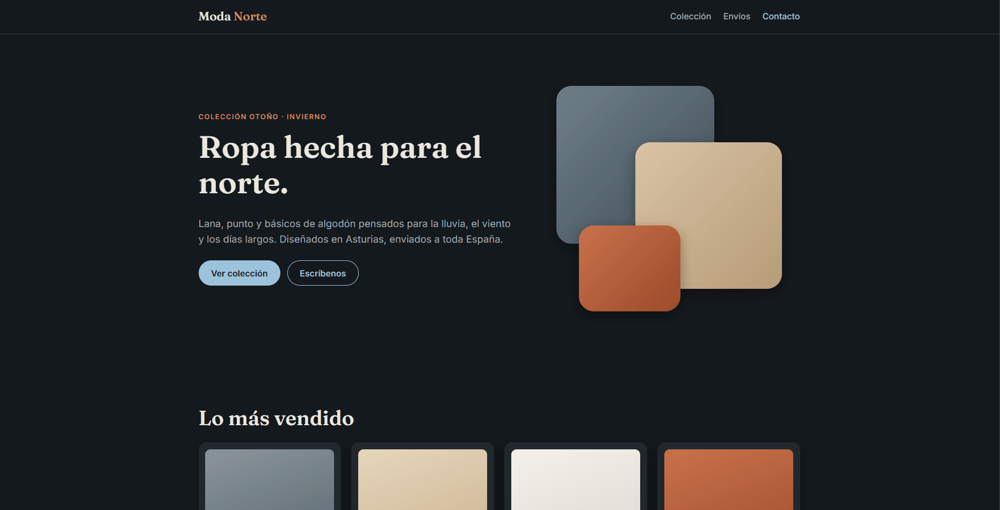
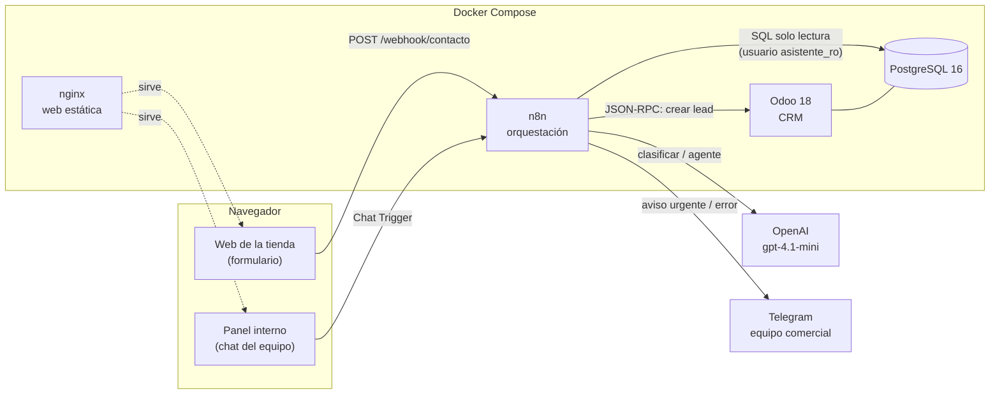
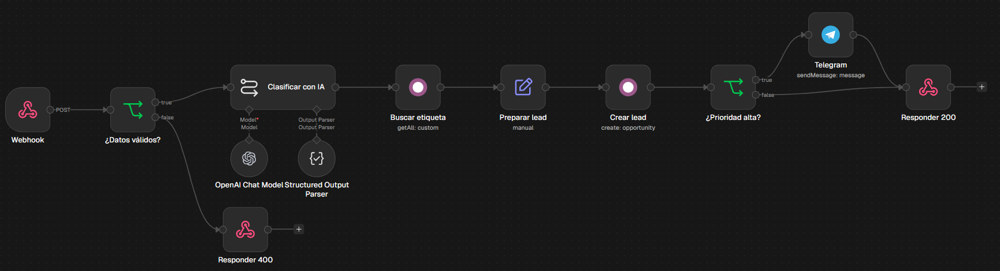
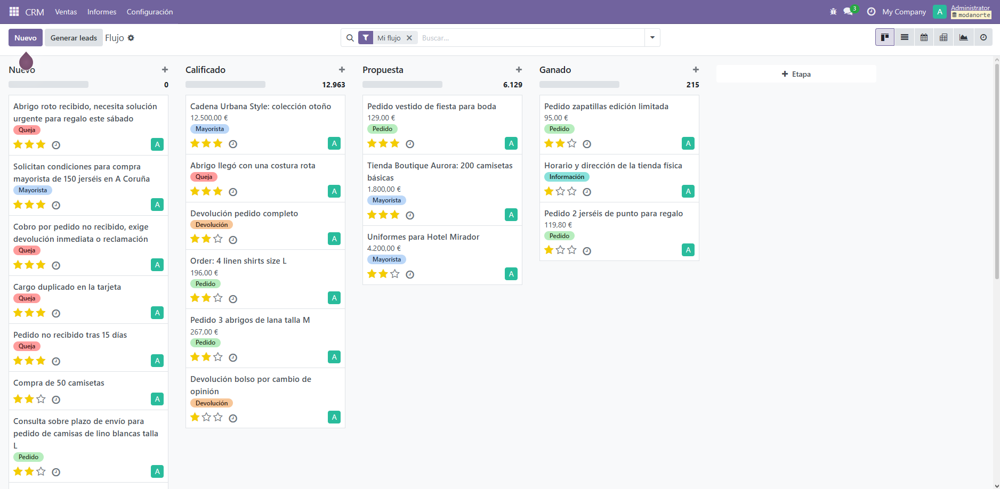
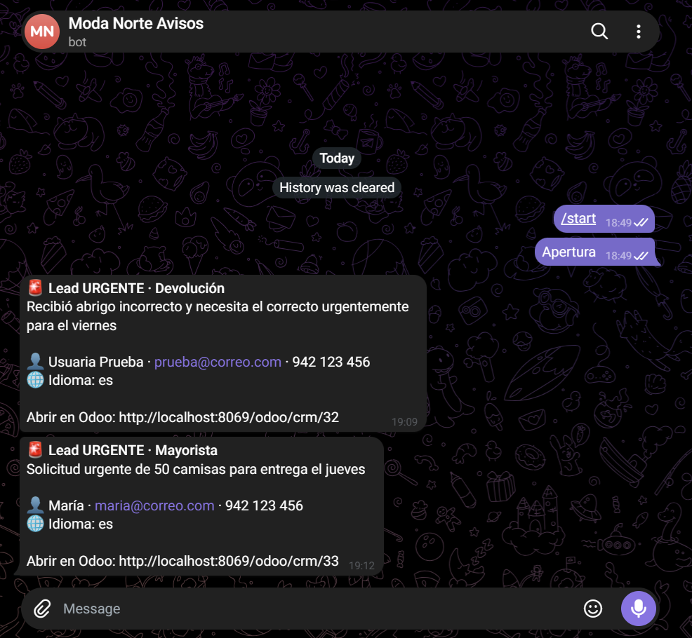
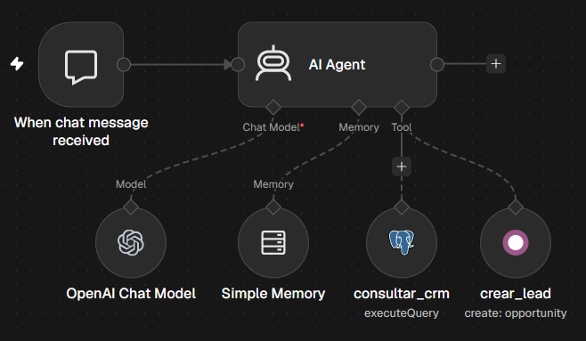
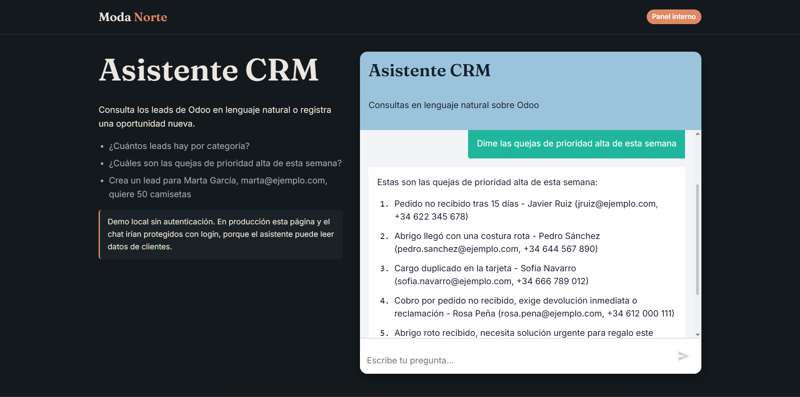
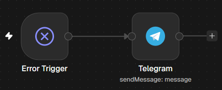

# Moda Norte · Atención al cliente con IA (n8n + GPT + Odoo CRM)

**Cada mensaje que llega por la web se clasifica con IA, se registra como oportunidad en Odoo CRM y, si es urgente, se avisa al equipo por Telegram en segundos. Además, el equipo tiene un asistente para consultar el CRM en lenguaje natural.**



---

## 1. El problema y la solución

**Problema.** Moda Norte es una tienda de ropa online (ficticia). Recibe por su web mensajes muy distintos: pedidos, devoluciones, quejas, compras al por mayor y dudas sobre tallas. Alguien tiene que leerlos uno a uno, decidir qué son, copiarlos al CRM y adivinar cuáles corren prisa. Eso tiene tres consecuencias:
- se pierde tiempo copiando datos a mano;
- una queja grave puede esperar horas en la bandeja;
- un pedido mayorista puede pasar desapercibido.

**Solución.**
1. **Captación automática:** cuando un cliente escribe, una IA lee el mensaje y decide su **categoría**, su **prioridad**, un **resumen** y el **idioma**. Con eso se crea la oportunidad en el CRM ya etiquetada y con sus estrellas de prioridad. Si es urgente, el equipo comercial recibe un **aviso en el móvil**.
2. **Asistente del CRM:** el equipo puede preguntar en lenguaje natural, por ejemplo *"¿cuántas quejas urgentes hay esta semana?"*, y el asistente consulta la base de datos. También puede **dar de alta un lead** desde la conversación, siempre pidiendo confirmación antes.
3. **Vigilancia:** si cualquier automatización falla, llega un aviso con qué falló y dónde, para que ningún mensaje se pierda en silencio.

## 2. Arquitectura



En [docs/arquitectura.md](docs/arquitectura.md) está el recorrido de un mensaje de principio a fin y el detalle de la red y la seguridad.

## 3. Tecnologías

| Pieza | Tecnología | Para qué |
|---|---|---|
| Orquestación | **n8n** (self-hosted, Docker) | Flujos de automatización y agente de IA |
| CRM | **Odoo 18 Community** + módulo CRM | Oportunidades (`crm.lead`), etiquetas y pipeline |
| Base de datos | **PostgreSQL 16** | Datos de Odoo; el asistente la lee con un usuario de solo lectura |
| IA generativa | **OpenAI `gpt-4.1-mini`** | Clasificación con salida JSON estricta y agente con herramientas |
| Notificaciones | **Bot de Telegram** | Avisos de leads urgentes y de errores |
| Web | HTML + CSS + JS (sin framework) + **`@n8n/chat`** | Formulario de contacto y chat del equipo |
| Scripts | **Python** (XML-RPC) y **SQL** | Datos de prueba y usuario de solo lectura |
| Despliegue | **Docker Compose** | Los 5 servicios con un solo comando |

## 4. Cómo arrancarlo

**Requisitos:**
- Docker Desktop
- Python 3.10+
- una API key de OpenAI con algo de crédito (con 5 $ sobra)
- un bot de Telegram: el token te lo da [@BotFather](https://t.me/BotFather), y tu `chat_id` lo ves en `https://api.telegram.org/bot<TOKEN>/getUpdates` después de escribirle al bot

### 4.1 Infraestructura
```bash
git clone https://github.com/adrian-glez-baamonde/n8n-odoo-ai-crm.git
cd n8n-odoo-ai-crm
cp .env.example .env
```
Edita `.env`:
- pon contraseñas propias en `POSTGRES_PASSWORD` y `ASISTENTE_RO_PASSWORD`;
- genera `N8N_ENCRYPTION_KEY` con `python -c "import secrets; print(secrets.token_hex(32))"`.

Después:
```bash
docker compose up -d
```

| Servicio | URL |
|---|---|
| Odoo | http://localhost:8069 |
| n8n | http://localhost:5678 |
| Web de la tienda | http://localhost:8080 (puerto configurable con `WEB_PORT`) |

### 4.2 Odoo
1. En http://localhost:8069, crea la base de datos `modanorte` **sin datos de demostración**.
2. Instala la app **CRM**.
3. Activa el *modo desarrollador* (Ajustes, al final de la página).
4. En **Mi perfil → Seguridad de la cuenta → Nueva clave API**, crea dos claves: `seed-script-local` y `n8n-local`.
5. Rellena en `.env`: `ODOO_USER` (tu email de Odoo) y `ODOO_API_KEY` (la clave `seed-script-local`).

### 4.3 Datos de prueba y usuario de solo lectura
```bash
python scripts/seed_odoo.py      # 5 etiquetas + 20 oportunidades (idempotente)
```
Crea el usuario de solo lectura (sustituye `TU_PASSWORD` por el valor de `ASISTENTE_RO_PASSWORD`):
```bash
# Bash / Git Bash
docker compose exec -T db psql -U odoo -d modanorte -v pwd="TU_PASSWORD" < scripts/create_readonly_user.sql
```
```powershell
# PowerShell
Get-Content scripts/create_readonly_user.sql | docker compose exec -T db psql -U odoo -d modanorte -v pwd="TU_PASSWORD"
```

### 4.4 n8n
1. En http://localhost:5678, crea la cuenta de propietario.
2. **Credentials → Create**:

   | Credencial | Datos |
   |---|---|
   | **OpenAI** | tu API key |
   | **Odoo API** (la de *Username & Password*) | URL `http://odoo:8069` · usuario: tu email · contraseña: la API key `n8n-local` · BD `modanorte` |
   | **Telegram** | el token del bot |
   | **Postgres** | host `db` · BD `modanorte` · usuario `asistente_ro` · contraseña: `ASISTENTE_RO_PASSWORD` · puerto `5432` · SSL `disable` |

   Ojo: la opción de Odoo "API Key (Recommended)" **solo funciona con Odoo 19+**. Con Odoo 18 hay que usar *Username & Password*, poniendo la API key como contraseña.
3. **Importa los flujos** en este orden: `99`, `01`, `02`. Para cada uno: *Create workflow* → menú **⋯ → Import from File** → elige el JSON de [`workflows/`](workflows/).
4. En cada flujo:
   - abre los nodos que usan credenciales y elige las tuyas;
   - en los nodos de Telegram, sustituye `TU_CHAT_ID` por tu `chat_id`.
5. **Publica el flujo 99.** En n8n 2.x tiene que estar publicado para poder elegirlo como flujo de errores.
6. En los flujos 01 y 02: **⋯ → Settings → Error Workflow** = `99 - Gestión de errores`. Después **publícalos**.
7. Comprueba que la URL del nodo *When chat message received* (flujo 02) coincide con `CHAT_WEBHOOK_URL` en [`web/app.js`](web/app.js).

### 4.5 Probarlo
- **Web:** abre http://localhost:8080 y envía el formulario. En **Acceso equipo** está el chat.
- **Desde la terminal**, con los mensajes de [`tests/contacto/`](tests/contacto/):
  ```bash
  curl -X POST http://localhost:5678/webhook/contacto -H "Content-Type: application/json" -d @tests/contacto/01-queja-urgente.json
  ```
  En PowerShell usa `curl.exe` y pon la ruta del fichero entre comillas: `-d "@tests/contacto/01-queja-urgente.json"`.

## 5. Los flujos

### 01 · Captación y clasificación de leads


`Webhook POST /contacto` → **validación** (email válido y mensaje no vacío; si falla, responde `400`) → **Basic LLM Chain + Structured Output Parser**. GPT devuelve un JSON validado contra un esquema:
```json
{ "categoria": "Queja", "prioridad": "alta", "resumen": "Cobro por pedido no recibido...", "idioma": "es" }
```
Después: se **busca la etiqueta** en Odoo → se **crea la oportunidad** con contacto, mensaje, estrellas y etiqueta → **si la prioridad es alta**, aviso por Telegram con un enlace al lead → respuesta `200 {"ok": true, "lead_id": N}`.

Sobre el prompt:
- rol del modelo, definición de cada categoría, regla de desempate y 3 ejemplos *few-shot*;
- `temperature: 0`, porque clasificar debe dar siempre el mismo resultado;
- el mensaje del cliente va delimitado y marcado como *dato*, como defensa contra la inyección de prompts.




### 02 · Asistente de IA del CRM


`Chat Trigger` → **AI Agent** (`gpt-4.1-mini`) con **Simple Memory** y dos herramientas:
- **`consultar_crm`:** ejecuta SQL en PostgreSQL con un **usuario de solo lectura**. La descripción de la herramienta incluye el esquema de las tablas, para que el modelo genere SQL correcto.
- **`crear_lead`:** crea la oportunidad en Odoo **después de pedir confirmación** al usuario.

La seguridad no depende del prompt. El usuario `asistente_ro`:
- solo tiene `SELECT` sobre 5 tablas;
- tiene transacciones de solo lectura por defecto;
- tiene un tiempo máximo de 5 s por consulta.

Si se le pide "borra todos los leads", el agente se niega. Y si lo intentara, PostgreSQL lo rechazaría.



### 99 · Gestión de errores


`Error Trigger` → Telegram con el flujo, el nodo que falló, el mensaje de error, la hora y un enlace a la ejecución. Está configurado como *Error Workflow* de los flujos 01 y 02.

## 6. Decisiones técnicas y mejoras futuras

Las decisiones de cada fase, con su porqué y los problemas reales que surgieron, están en **[docs/decisiones.md](docs/decisiones.md)**. Las más importantes:
- **Seguridad en la base de datos, no en el prompt:** el agente que escribe SQL usa un usuario con mínimo privilegio.
- **Salida estructurada con JSON Schema y `enum`:** la IA no puede inventar categorías que no existan en el CRM.
- **El chat del equipo no está en la web pública:** podría filtrar datos personales de clientes.
- **Depuración de agentes mirando sus llamadas a herramientas:** así se encontró que el SQL usaba un campo de traducción vacío.
- **Escapar los datos del usuario** antes de meterlos en un formato (HTML de Telegram).

**Mejoras futuras:**
- **Más canales de entrada:** email (Gmail/IMAP) y WhatsApp, reutilizando la misma clasificación.
- **RAG con el catálogo de productos:** que el asistente responda sobre stock, tallas y precios.
- **Métricas:** tiempo ahorrado por lead, precisión de la clasificación (comparando con las correcciones del equipo) y coste de la IA por mes.
- **Producción:**
  - autenticación en el webhook y en el chat, y HTTPS;
  - memoria del agente en Postgres o Redis;
  - deduplicación de leads por email;
  - reintentos automáticos en las llamadas a APIs externas.

---

Proyecto de portfolio de **Adrián González Baamonde**: automatización e IA aplicada a procesos de negocio.
