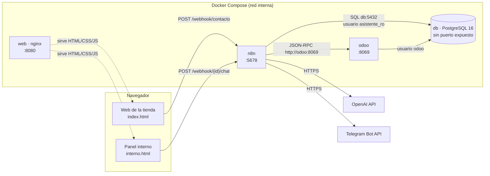

# Arquitectura

## Diagrama



## Componentes

| Servicio | Imagen | Puerto en el host | Función |
|---|---|---|---|
| `db` | `postgres:16` | — (no expuesto) | Base de datos de Odoo |
| `odoo` | `odoo:18` | 8069 | CRM: oportunidades, etiquetas, pipeline |
| `n8n` | `docker.n8n.io/n8nio/n8n` | 5678 | Flujos 01, 02 y 99; guarda sus datos en su propio SQLite |
| `web` | `nginx:1.27-alpine` | 8080 | Sirve `web/` en solo lectura |

**Red:** Docker Compose crea una red privada con DNS interno, y cada servicio es accesible por su **nombre**. Por eso n8n usa `http://odoo:8069` y `db:5432`, y no `localhost`: dentro de un contenedor, `localhost` es ese mismo contenedor. Para el navegador, en cambio, todo está en `localhost:<puerto>`.

**Datos persistentes:** son volúmenes con nombre (`odoo-db-data`, `odoo-web-data`, `n8n-data`). `docker compose down` los conserva y `down -v` los borra.

## Recorrido de un mensaje: del formulario al comercial

1. **Cliente → web.** Rellena el formulario en `http://localhost:8080`. `app.js` valida los campos en el navegador y hace `fetch` POST con `{nombre, email, telefono, mensaje}` a `http://localhost:5678/webhook/contacto`.
2. **CORS.** Como la web (`:8080`) y n8n (`:5678`) son orígenes distintos, el navegador manda antes una petición `OPTIONS`. n8n responde con `Access-Control-Allow-Origin` y el navegador deja pasar el POST.
3. **Webhook (flujo 01).** n8n recibe la petición. El nodo `¿Datos válidos?` comprueba el email (expresión regular) y que el mensaje no esté vacío. Si falla, `Responder 400` contesta y el flujo termina.
4. **Clasificación con IA.**
   - `Clasificar con IA` envía a OpenAI el *prompt de sistema* (rol, categorías, criterios de prioridad y ejemplos) y el mensaje entre `<mensaje>…</mensaje>`, con `temperature: 0`.
   - El `Structured Output Parser` valida la respuesta contra un JSON Schema con `enum`. Si no cumple, el nodo falla.
5. **Etiqueta.** `Buscar etiqueta` consulta `crm.tag` en Odoo por nombre (p. ej. `Queja`) y obtiene su `id`.
6. **Preparar y crear el lead.**
   - `Preparar lead` monta el JSON exacto de `crm.lead`: `name` = resumen, `contact_name`, `email_from`, `phone`, `description` = mensaje original e idioma, `priority` = estrellas (`baja→'1'`, `media→'2'`, `alta→'3'`), `tag_ids` = `[id]`.
   - `Crear lead` lo envía a Odoo por JSON-RPC (`http://odoo:8069/jsonrpc`), autenticado con la API key `n8n-local`.
   - Odoo lo guarda en PostgreSQL y devuelve el `id`.
7. **Urgencia.** Si la prioridad es `alta`, el nodo Telegram envía al equipo la categoría, el resumen, los datos de contacto, el idioma y el enlace `http://localhost:8069/odoo/crm/<id>`. El texto va en HTML.
8. **Respuesta.** `Responder 200` devuelve `{"ok": true, "lead_id": <id>}` y la web muestra "¡Gracias!".
9. **Si algo falla** en cualquier paso (por ejemplo, la API key de OpenAI no es válida):
   - el cliente recibe un `500` y la web muestra un mensaje amable;
   - n8n ejecuta el flujo **99**, que avisa por Telegram del flujo, el nodo y el error.

## Recorrido de una pregunta al asistente

1. Un miembro del equipo escribe en `interno.html`: *"¿Cuáles son las quejas de prioridad alta de esta semana?"*. El widget `@n8n/chat` lo envía al Chat Trigger del flujo 02 junto con un `sessionId`.
2. El **AI Agent** recibe:
   - el mensaje;
   - la conversación previa de esa sesión (*Simple Memory*);
   - el prompt de sistema, con la fecha actual;
   - la lista de herramientas, con sus descripciones.
3. El modelo decide llamar a `consultar_crm` y genera el SQL a partir del esquema que aparece en la descripción de la herramienta:
   ```sql
   SELECT l.id, l.name, l.create_date
   FROM crm_lead l
   JOIN crm_tag_rel tr ON l.id = tr.lead_id
   JOIN crm_tag t ON tr.tag_id = t.id
   WHERE l.active = true
     AND COALESCE(t.name->>'es_ES', t.name->>'en_US') = 'Queja'
     AND l.priority = '3'
     AND l.create_date >= date_trunc('week', now())
   ORDER BY l.create_date DESC LIMIT 50;
   ```
4. n8n ejecuta la consulta en `db:5432` como **`asistente_ro`** y devuelve las filas al modelo.
5. El modelo redacta la respuesta en lenguaje natural, que vuelve al chat.
6. Para **crear** un lead, el agente primero resume los datos y pide confirmación. Solo después del "sí" llama a `crear_lead`, que crea la oportunidad en Odoo.

## Seguridad

| Riesgo | Medida |
|---|---|
| El agente genera SQL destructivo, por error o por manipulación | Usuario `asistente_ro`: solo `SELECT` sobre 5 tablas, `default_transaction_read_only = on` y `statement_timeout = 5s`. La seguridad está en la base de datos, no en el prompt |
| Datos sensibles de Odoo (p. ej. `res_users`) | Sin permiso de lectura: *permission denied* |
| Inyección de prompts en el formulario | Mensaje delimitado con `<mensaje>` y tratado como dato; salida forzada a un JSON Schema con `enum` |
| Datos de clientes expuestos en el chat público | El chat solo está en el panel interno. En producción, con autenticación |
| Datos del usuario que rompen el formato del aviso | Mensajes de Telegram en HTML y mensaje de error escapado (`&`, `<`, `>`) |
| Secretos en el repositorio | Solo en `.env` (ignorado por git). Los flujos exportados llevan referencias a credenciales, no claves. Historial auditado |
| PostgreSQL accesible desde fuera | El puerto no se publica en el host: solo lo alcanzan los contenedores de la red |
| Fallos silenciosos | Flujo 99 con aviso por Telegram |
